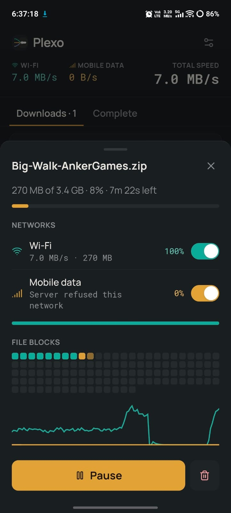
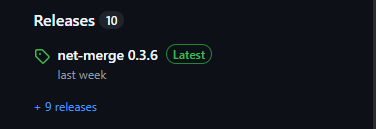

# Plexo

**Plexo is an Android download manager prototype that can split a supported file download across Wi-Fi and mobile data.** It uses a React + TypeScript interface and a native Capacitor Android plugin to route individual HTTP range requests through a selected Android network.

> **Current project version:** `0.3.7`  
> **Android version code:** `4`  
> **Release tag:** `v0.3.7`

## App preview

<p align="center">
  
</p>

The screenshot shows Plexo's download details sheet, network switches, progress, file-block visualization and speed history. Network speeds in the screenshot are an example from one test session; actual results depend on the phone, network, carrier and download host.

## Features

- React-based mobile interface built with Vite and TypeScript.
- Capacitor 7 Android application shell.
- Local `plexo-engine` native Android plugin.
- Per-network HTTP probing and redirect handling.
- HTTP byte-range downloads distributed across selected available networks.
- Per-network progress and speed reporting in the download UI.
- Browser-based UI preview using a simulated download engine.
- GitHub Actions workflow for cloud APK builds and tagged GitHub Releases.

## How multi-network downloading works

1. Plexo checks the original download URL through each selected Android network independently.
2. A network is eligible for split downloading only when the server supports compatible HTTP byte-range responses. A typical successful range response is `206 Partial Content`.
3. The native engine divides the file into byte ranges and schedules ranges across the eligible networks.
4. Each network follows its own redirect chain. A temporary redirect URL discovered over Wi-Fi is not reused for cellular, because some hosts bind temporary URLs to the source IP or session.
5. If a selected network becomes unavailable or fails, another eligible network can take over ranges that have not already been completed.

### Important limitations

Plexo cannot force a server to accept a request. Multi-network downloading depends on all of the following:

- The download server supports HTTP `Range` requests and returns a valid `206 Partial Content` response.
- The server/CDN accepts requests arriving independently over both networks. Some hosts, signed URLs, anti-bot systems or IP-bound links may refuse one route.
- Android and the phone manufacturer allow the app to use both Wi-Fi and cellular networks at the same time.
- Both networks have working Internet access. Carrier policies, VPNs, private DNS, captive portals and device power settings can affect routing.

If a host rejects cellular requests, Plexo must report that route as unavailable for that download; the app cannot bypass the host's restriction. A download can still continue over another eligible network.

## Technology stack

| Area | Technology |
|---|---|
| UI | React 19, TypeScript |
| Development server / web build | Vite 6 |
| Mobile bridge | Capacitor 7 |
| Android native engine | Java, Android `ConnectivityManager` / `Network` APIs |
| Styling | Tailwind CSS 4, custom CSS |
| CI and APK builds | GitHub Actions, Gradle |

## Project structure

```text
plexo-mobile/
├── .github/
│   └── workflows/
│       └── android-apk.yml       # Build APK and publish tagged releases
├── docs/
│   └── screenshots/              # README screenshots
├── plugins/
│   └── plexo-engine/
│       ├── android/               # Native Android download engine
│       ├── ios/                   # iOS plugin source
│       ├── index.js               # Capacitor plugin entry point
│       └── package.json
├── public/                        # Public web assets
├── resources/                     # App icon resources
├── scripts/
│   └── set-android-version.mjs    # Applies version to generated Android app
├── src/                           # React UI and TypeScript logic
├── capacitor.config.ts
├── package.json
├── RELEASE_NOTES.md
└── README.md
```

## Run the browser preview

The browser preview is useful for checking layout, navigation and UI interactions. It uses the project's simulated engine; it does **not** test Android's native Wi-Fi/cellular routing.

### Requirements

- Node.js 22 or newer.
- npm.
- VS Code or another code editor.

### Install and run

```bash
npm install
npm run dev -- --host 0.0.0.0
```

Vite prints a local URL and a network URL. To open the app on an Android phone:

1. Connect the phone and laptop to the same Wi-Fi network.
2. Allow Node.js through the Windows Firewall on a private network if prompted.
3. Open the Vite **Network** URL in Chrome on the phone.

For example:

```text
http://192.168.1.5:5173
```

Use the actual IP and port printed by Vite; the example above is not a fixed address.

### Run project checks

```bash
npm test
npm run test:native
npm run build
```

`npm run test:native` runs the lightweight Java checks for the native chunk scheduler. A complete Android build is performed by the GitHub Actions workflow described below.

## Build and install an Android debug APK

You do not need Android Studio on your development laptop. GitHub Actions creates the Capacitor Android project, installs the Android SDK on a hosted runner and builds the debug APK in the cloud.

1. Push the project to your GitHub repository.
2. Open the repository's **Actions** tab.
3. Select **Build Plexo Android APK**.
4. Run the workflow manually, or push a normal branch commit.
5. When the workflow succeeds, open the run and download the `plexo-android-debug-apk` artifact.
6. Extract the artifact ZIP and transfer `app-debug.apk` to your Android phone.
7. Open the APK on the phone and approve installation if Android asks.

The workflow caches its debug signing key. Keep that GitHub Actions cache available between builds to allow later debug APKs to update an app installed from a previous build. If an APK was signed with a different key, Android will reject it as an update; uninstall the old test app before installing the new APK. Uninstalling can remove the app's local data.

**Debug-build note:** The APK produced by this workflow is intended for development and testing. It is not a production-signed Google Play release. Do not publish the debug APK to Google Play.

## Create a GitHub Release

The workflow also publishes a GitHub Release whenever you push a version tag matching `v*`. It builds the APK, creates a SHA-256 checksum file and attaches both files to the release. The release will appear in the repository's **Releases** section, similar to the example below. The release workflow marks this new `0.3.7` release as **Latest**. The action only runs when you push the matching version tag.

<p align="center">
  
</p>

The screenshot above is a visual reference for the GitHub Releases list. Your repository will show the Plexo release title and tag, for example `Plexo v0.3.7` and `v0.3.7`.

### Publish the current version `v0.3.7`

First, commit and push the release-ready files to your default branch:

```bash
git add .
git commit -m "Prepare Plexo v0.3.7 release"
git push
```

Then create and push the annotated tag:

```bash
git tag -a v0.3.7 -m "Plexo v0.3.7"
git push origin v0.3.7
```

Pushing the tag starts the workflow. When it succeeds, GitHub creates a release titled **Plexo v0.3.7** and attaches:

- `Plexo-0.3.7-debug.apk`
- `Plexo-0.3.7-SHA256SUMS.txt`

To view it, open **GitHub repository → Releases**. GitHub will show the release in the Releases list. The workflow requests the **Latest** label for this `0.3.7` release.

> Only create the `v0.3.7` tag once. If that tag already exists, do not move or overwrite it. Use the next version number for new code.

> **Version note:** I selected `0.3.7` because the screenshot shows `0.3.6` as the current Latest release. This assumes the screenshot is from the same repository. If it is only a visual example, or if tag `v0.3.7` already exists, choose the next unused version and update both package versions, the Android version code and `RELEASE_NOTES.md` before tagging.

## Versioning for future changes

Keep the app version, local plugin version and Git tag in sync.

For the next patch release, for example `0.3.8`:

1. Change the root `package.json` version to `0.3.8`.
2. Change `plugins/plexo-engine/package.json` version to `0.3.8`.
3. Increase `ANDROID_VERSION_CODE` in `.github/workflows/android-apk.yml` from `4` to `5`. Increase it again for every future APK that should update an installed app.
4. Update `RELEASE_NOTES.md` for the new version.
5. Commit and push the changes.
6. Create and push the matching tag `v0.3.8`.

Example commands after editing the version files and notes:

```bash
git add package.json plugins/plexo-engine/package.json \
  .github/workflows/android-apk.yml RELEASE_NOTES.md
git commit -m "Prepare Plexo v0.3.8 release"
git push
git tag -a v0.3.8 -m "Plexo v0.3.8"
git push origin v0.3.8
```

Use semantic versioning:

- **Patch** (`0.3.7` → `0.3.8`): bug fixes and small improvements.
- **Minor** (`0.3.7` → `0.4.0`): backward-compatible features.
- **Major** (`0.x` → `1.0.0`): a significant milestone or incompatible change.

The Android `versionCode` is a separate, increasing integer. Never reuse a code that has already been distributed to testers.

## Troubleshooting native network routes

Connect the Android phone to the laptop with USB debugging enabled and ADB installed, then run:

```bash
adb devices
adb logcat -c
adb logcat -s PlexoNets:I
```

Open Plexo and start a download. Check the diagnostic lines for network discovery and independent HTTP results over Wi-Fi and cellular. Do not post signed download URLs, authorization headers or private tokens in public logs or issue reports.

If Wi-Fi works but cellular is refused by the host, try a different direct file URL from a server known to support byte ranges. Confirm that the server accepts the same file over both network routes. The app can only combine routes the server and Android device actually permit.

## License

This project is licensed under the MIT License. See [LICENSE](LICENSE) and [NOTICE.md](NOTICE.md) for details and third-party notices.
